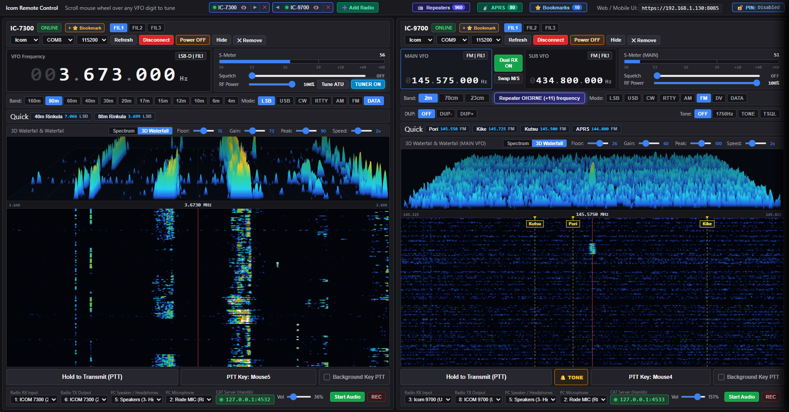
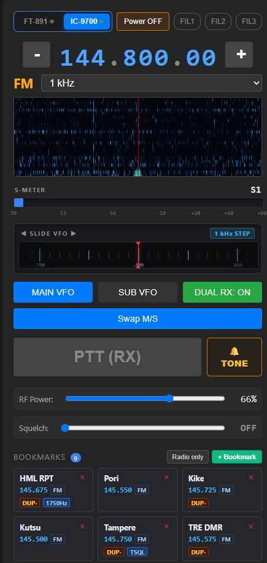

# Icom & Yaesu Remote - Multi-Radio Web & Desktop Controller

A modern, high-performance remote control and spectrum monitoring application for **Icom transceivers** (**IC-7300**, **IC-9700**, and other CI-V radios) as well as **Yaesu HF transceivers** (**FT-891**, **FT-991A**, **FT-DX10**).

Featuring real-time 2D/3D waterfall spectrum display with interactive bookmark markers, ultra-low-latency (16 ms) bidirectional audio streaming & contest-grade PTT turnaround, VHF/UHF repeater & CTCSS / 1750 Hz tone burst automation, built-in Hamlib `rigctld` server for WSJT-X / digital modes, per-radio WAV audio recording, APRS digipeater with OpenStreetMap, and a mobile-friendly HTTPS interface.

 

<table align="center">
  <tr>
    <td align="center" valign="top">
      
       
      <b>HF Mobile View</b> (IC-7300 / FT-891)
    </td>
    <td align="center" valign="top">
      
       
      <b>VHF/UHF Mobile View</b> (IC-9700)
    </td>
  </tr>
</table>

 

### Mobile Remote Access & Web Interface

Control and monitor your transceivers on the go from any smartphone, tablet, or secondary laptop on your local Wi-Fi or secure VPN (Tailscale, WireGuard).

* **Tailored Dual-Radio Layouts:** Dedicated mobile views for HF transceivers (IC-7300 / FT-891) and VHF/UHF transceivers (IC-9700 with MAIN VFO, SUB VFO, Dual RX, Swap M/S, and 1750 Hz Repeater Tone burst).
* **Horizontal Slide / Jog VFO Ribbon:** Natural 1:1 tactile dragging with weighted flywheel inertia momentum and instant touch braking.
* **Interactive S-Meter & Squelch:** Multi-stop gradient meter with visual squelch threshold indicator (amber armed / glowing green open) and tap-to-set squelch control.
* **Bidirectional Low-Latency Audio:** High-fidelity audio streaming with 2.8x base preamp boost matching standard Windows listening volume, soft compression limiter, and instant touch-and-hold PTT using your phone's microphone.
* **Interactive Bookmarks:** Live synchronization with desktop memory channels and one-tap tuning to repeaters and favorite frequencies.
* **Configurable PIN Security:** Secure HTTPS encryption with an optional 4-digit PIN code (easily modified or disabled in settings).

 

---

## Core Features

- **Multi-Radio Management (Up to 3 Radios Simultaneously):**
  - Control up to three transceivers at the same time (e.g., **IC-7300** for HF/50 MHz, **IC-9700** for VHF/UHF/1.2 GHz, and **Yaesu FT-891**).
  - Independent VFO controls, IC-9700 Dualwatch (`MAIN` & `SUB` VFO) synchronization, split operation, and quick band switching.

- **High-Resolution 2D & 3D Waterfall & Spectrum Engine:**
  - Real-time CI-V spectrum scope capture directly over USB at up to 60 FPS (plus 4096-point Hanning FFT audio scope for Yaesu).
  - **1D Peak Sharpening & Adaptive Noise Gate:** Keeps background band noise dark and clean while illuminating weak signals and SSB speech formants.
  - **Interactive Bookmark Overlay:** Displays saved bookmarks directly on the waterfall at their exact RF coordinates.
  - **Dynamic Floor, Gain, Peak & Speed Controls:** Floor range `-30` to `+60`, Gain `10` to `200`, Peak `30` to `160`, and scroll speed `1x` to `5x` with persistent per-radio memory.
  - **Interactive 3D Waterfall (3DSS):** High-density perspective surface ridges with synchronized dynamic range.
  - **Click-to-Tune & Mouse Wheel Tuning:** Click anywhere on the spectrum, waterfall, or bookmark markers to tune; hover and scroll mouse wheel to step in 0.5 kHz increments.

- **Low-Latency Bidirectional Audio & Contest PTT:**
  - Isolated audio paths: streaming audio to a mobile phone or remote browser does **not** trigger the local PC speakers in the shack.
  - Ultra-low 16 ms audio block processing with anti-VOX loopback protection for external interfaces (e.g., SignaLink USB).
  - Bind any keyboard key or mouse side button (`Mouse4`, `Mouse5`, `MouseMid`) as a local or global PTT trigger.

- **Frequency Bookmarks, Quick Bar & Repeater Profiles:**
  - Per-radio filtered **Quick Bookmarks** strip right below the VFO display (shows only bookmarks assigned to that specific transceiver).
  - Strict target radio locking (`IC-7300`, `IC-9700`, `Yaesu FT-891`, or `AUTO`) with a smooth *"Radio not connected"* fade notification if the target radio is offline.
  - Store complete VHF/UHF repeater profiles (`DUP-`/`DUP+`, `Shift MHz`, `TONE`/`TSQL`/`1750Hz`, and `CTCSS Hz`) inside bookmarks.
  - **Drag-and-Drop Reordering:** Freely rearrange saved station memories with drag handle (`⠿`) or quick `▲` / `▼` step buttons.

- **Mobile Web Interface (HTTPS) & Configurable PIN Security:**
  - Fully responsive web UI accessible from any smartphone, tablet, or secondary laptop on your LAN/Wi-Fi or over VPN/Tailscale.
  - Secure HTTPS support for microphone input and Web Audio API permissions.
  - **Configurable PIN Protection:** Quick topbar button to change PIN code or disable PIN prompt completely for seamless local network access.

- **Built-in Hamlib `rigctld` Emulation:**
  - Integrated rigctld TCP servers (ports `4532`, `4533`, and `4534`).
  - Connect **WSJT-X**, **JTDX**, **FLDigi**, **Log4OM**, or **N1MM** directly over TCP without needing physical CI-V splitters or virtual COM-port pairs.

- **Integrated 2m APRS Packet Radio, OpenStreetMap & Digipeater:**
  - Real-time 1200 baud Bell 202 AFSK packet demodulation directly from radio USB audio (144.800 MHz FM with Frequency Safety Lock).
  - Interactive **OpenStreetMap / CartoDB Dark Matter** station map with APRS symbols, SSID badges, distance/bearing, and weather station telemetry.
  - Autonomous **New-N Paradigm (`WIDE1-1`, `WIDE2-n`) Digipeater** with duplicate suppression, carrier-sense (CSMA), and periodic position/weather beaconing.

---

## Obtaining the Software

The software and executable packages are available directly from the author:
- Email: [jorksx@gmail.com](mailto:jorksx@gmail.com)
- Website: [oh1w.fi/remote](https://oh1w.fi/remote)
