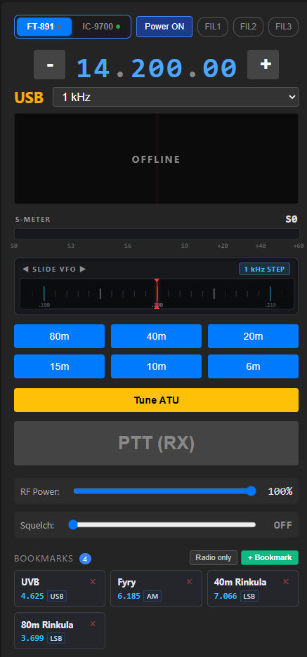

# Icom & Yaesu Remote - Multi-Radio Web & Desktop Controller

A modern, high-performance remote control and spectrum monitoring application for **Icom transceivers** (**IC-7300**, **IC-9700**, and other CI-V radios) as well as **Yaesu HF transceivers** (**FT-891**, **FT-991A**, **FT-DX10**).

Featuring real-time 2D/3D waterfall spectrum display with interactive bookmark markers, ultra-low-latency (16 ms) bidirectional audio streaming & contest-grade PTT turnaround, VHF/UHF repeater & CTCSS / 1750 Hz tone burst automation, built-in Hamlib `rigctld` server for WSJT-X / digital modes, per-radio WAV audio recording, APRS digipeater with OpenStreetMap, and a mobile-friendly HTTPS interface.


<br>

<table>
  <tr>
    <td width="320" align="center" valign="top">
      
    </td>
    <td valign="top" style="padding-left: 18px;">
      <h3>📱 Mobile Remote Access & Web Interface</h3>
      <p>
        Control and monitor your transceivers on the go from any smartphone, tablet, or secondary laptop on your local Wi-Fi or secure VPN (Tailscale, WireGuard).
      </p>
      <ul>
        <li><strong>Live VFO Tuning & Modulation:</strong> Real-time frequency control, quick band jumping, and mode switching (USB, LSB, FM, AM, CW, Data).</li>
        <li><strong>Bidirectional Low-Latency Audio:</strong> High-fidelity audio streaming to your mobile browser with instant touch-and-hold PTT using your phone's microphone.</li>
        <li><strong>Interactive S-Meter & Bookmarks:</strong> Live signal strength metering and one-tap tuning to your saved repeater and simplex channels.</li>
        <li><strong>Configurable PIN Security:</strong> Secure HTTPS encryption with an optional 4-digit PIN code (easily modified or disabled in settings).</li>
      </ul>
      <p><strong>📲 Connecting from Mobile:</strong></p>
      <ol>
        <li>Connect your phone/tablet to the same Wi-Fi or VPN as the host PC.</li>
        <li>Open the local HTTPS address displayed in the desktop app (e.g. <code>https://192.168.1.xxx:8085</code>).</li>
        <li>Accept the self-signed SSL certificate warning once to enable audio/mic permissions.</li>
        <li>Enter your PIN code (if enabled) and enjoy full wireless remote control!</li>
      </ol>
    </td>
  </tr>
</table>

<br>

---

## 🆕 What's New (Latest Release)

- **🌐 Full WSJT-X / WSJT-Z Integration with Multi-Instance Hamlib `rigctld`:**
  - **Yaesu FT-891 D-U (DATA-USB) Automation:** `dump_state` now advertises full packet data capability (`0x1dff` with `PKTUSB`, `PKTLSB`, `PKTFM` and `0xc0c` filter bitmasks). When WSJT-X is in Data/Pkt mode (`M PKTUSB -1`), the server automatically switches the FT-891 directly to `MD0C;` (D-U mode) without manual UI intervention.
  - **Icom IC-9700 CAT PTT & "Fake It" Split Stabilization:** Fixed race condition where rapid back-to-back `F <freq>` (500 Hz shift) followed by `T 1` (PTT ON) caused the IC-9700 to drop PTT or step frequency backwards repeatedly. Added 25 ms settling delay, double CI-V PTT frame under serial lock, and strict CAT PTT ownership guard preventing stale RX poll responses (`1C 00 00`) from dropping TX.
  - **Multi-Instance Desktop Setup:** Full support for running 3 simultaneous WSJT-Z instances:
    - `WSJT-Z (ICOM 7300)`: Hamlib port `4532`, UDP `2237`
    - `WSJT-Z (ICOM 9700)`: Hamlib port `4533`, UDP `2238`
    - `WSJT-Z (Yaesu FT-891)`: Hamlib port `4532`, UDP `2239`
  - **Client Disconnect Fail-Safe:** Automatically unkeys rig PTT if a digital client crashes or abruptly closes its TCP connection.

- **🔇 Yaesu FT-891 CAT Polling Noise & Speaker Ticking Elimination:**
  - **Automatic Monitor Mute (`ML1000;ML0000;`):** Silences the notorious FT-891 hardware quirk where UART serial traces induce clicking into the internal monitor bus and external speaker. Sets Monitor Level to 0 (`ML1000;`) and Monitor OFF (`ML0000;`) on connection.
  - **Auto-Information Protocol (`AI1;`):** Enables unsolicited real-time dial and mode broadcasts from the FT-891, eliminating the need for continuous polling.
  - **Gentle Polling Cycle (75 ms -> 250 ms):** Reduced Yaesu CAT bus traffic by over 80%, polling only essential S-meter and PTT status at a relaxed 250 ms interval without audio chatter.

- **🎯 Streamlined Quick Bookmarks Bar:**
  - Stripped verbose repeater badges (`DUP- 0.6M`, `1750Hz`, `CTCSS`) from the Quick bookmarks chips below the VFO display for a clean, distraction-free view showing only station Name, Frequency, and Modulation Mode.

- **⚡ Ultra-Low Latency Contest PTT & RX Audio Recovery (16 ms):**
  - Zero-delay hardware PTT unkey (`TX0;` / `1C 00 00`) sent at `0 ms` before audio stream teardown.
  - Upgraded audio engine to `256`-sample (`16 ms`, `latency='low'`) blocks with asynchronous `abort()` TX teardown and instant speaker queue flush so you never miss the first syllable of an answering station in SSB contests.
  - Direct WebSocket PTT signaling and `5 ms` kernel-level keyboard & mouse side-button (`Mouse4` / `Mouse5` / `MouseMid`) PTT polling.

- **📍 Interactive Waterfall Bookmark Markers (IC-7300 & IC-9700):**
  - Saved bookmarks within the active waterfall span automatically appear on the 2D/3D hardware waterfall with a vertical dashed marker line, pointer triangle (`▼`), and station/repeater name badge (e.g., `Pori`).
  - **Click-on-Marker Tuning:** Click any bookmark badge directly on the waterfall to jump to that frequency and automatically load its mode and repeater settings.
  - Accurate CI-V `27 00` Division 1 real-time span decoding (`±2.5 kHz` .. `±500 kHz`) with left/right band-edge frequency indicators.
- **🗼 VHF/UHF Repeater, CTCSS & 1750 Hz Tone Burst System (IC-9700):**
  - Full repeater control bar for VHF/UHF: **DUP (`OFF` / `DUP-` / `DUP+`)**, **Shift Offset (MHz)**, **Tone Mode (`OFF` / `1750Hz` / `TONE` / `TSQL`)**, and **50 Standard CTCSS Sub-Audible Tones (`67.0 Hz` – `254.1 Hz`)**.
  - **Dedicated `🔔 TONE` (1750 Hz) Burst Button:** Compact wake-up tone button next to PTT that keys the radio and transmits a pure 1750 Hz sine wave burst (short click sends an automatic 650 ms pulse, or hold for manual length).
  - **Automatic Per-Repeater & Per-Frequency Memory:** Remembers `DUP`, `Shift`, `TONE`, and `CTCSS` settings for each repeater/bookmark automatically when switching frequencies.
  - **Smart Dual-VFO (`MAIN` / `SUB`) Band Swap:** Jumping from a VHF bookmark to a UHF bookmark (or vice versa) on IC-9700 automatically triggers `Swap M/S (07 B0)` so `MAIN VFO` seamlessly switches to the target band without flicker.
- **🔬 Razor-Sharp 2D & 3D Waterfall Engine:**
  - 1D Unsharp Mask peak deconvolution and 72nd-percentile adaptive noise floor tracking eliminate wide-pixel blur and background mush while keeping narrow CW/SSB/FM signals 1-pixel sharp.
  - Native 1×1 pixel high-DPI thermal noise decorrelation between CI-V sweeps.
- **📻 Up to 3 Simultaneous Radios & Full Yaesu FT-891 Support:**
  - Dynamic 1-to-3 radio deck layout (`IC-7300`, `IC-9700`, `Yaesu FT-891`) with top-bar visibility pills.
  - Full Yaesu CAT support including menu `11-07 [SSB BFO]` forced `LSB` / `USB` sideband switching, calibrated hardware S-meter (`S0..S9..+60dB`), and a dedicated **3.2 kHz Passband Audio FFT 2D/3D Waterfall**.
- **🎙️ Per-Radio Audio Recording (`REC` -> `.wav`) & Interactive S-Meter Squelch:**
  - Record received audio directly from any radio to a timestamped 16-bit PCM `.wav` file (`Model_Freq_Mode_Timestamp.wav`).
  - Clickable & draggable **SQL (Squelch)** threshold marker directly on the S-meter bar with automatic audio activation.

---

## ✨ Core Features

- **Multi-Radio Management (Up to 3 Radios Simultaneously):**
  - Control up to three transceivers at the same time (e.g., **IC-7300** for HF/50 MHz, **IC-9700** for VHF/UHF/1.2 GHz, and **Yaesu FT-891**).
  - Independent VFO controls, IC-9700 Dualwatch (`MAIN` & `SUB` VFO) synchronization, split operation, and quick band switching.

- **High-Resolution 2D & 3D Waterfall & Spectrum Engine:**
  - Real-time CI-V spectrum scope capture directly over USB at up to 60 FPS (plus 4096-point Hanning FFT audio scope for Yaesu).
  - **1D Peak Sharpening & Adaptive Noise Gate:** Keeps background band noise dark and clean while illuminating weak signals and SSB speech formants.
  - **Interactive Bookmark Overlay:** Displays saved bookmarks directly on the waterfall at their exact RF coordinates.
  - **Dynamic Floor, Gain, Peak & Speed Controls:** Floor range `-30` to `+60`, Gain `10` to `200`, Peak `30` to `160`, and scroll speed `1x` to `5x` with persistent per-radio memory.
  - **Interactive 3D Waterfall (3DSS):** High-density perspective surface ridges with synchronized dynamic range.
  - **Click-to-Tune & Mouse Wheel Tuning:** Click anywhere on the spectrum, waterfall, or bookmark markers to tune; hover and scroll mouse wheel to step in 0.5 kHz increments.

- **Low-Latency Bidirectional Audio & Contest PTT:**
  - Isolated audio paths: streaming audio to a mobile phone or remote browser does **not** trigger the local PC speakers in the shack.
  - Ultra-low 16 ms audio block processing with anti-VOX loopback protection for external interfaces (e.g., SignaLink USB).
  - Bind any keyboard key or mouse side button (`Mouse4`, `Mouse5`, `MouseMid`) as a local or global PTT trigger.

- **Frequency Bookmarks, Quick Bar & Repeater Profiles:**
  - Per-radio filtered **Quick Bookmarks** strip right below the VFO display (shows only bookmarks assigned to that specific transceiver).
  - Strict target radio locking (`IC-7300`, `IC-9700`, `Yaesu FT-891`, or `AUTO`) with a smooth *"Radio not connected"* fade notification if the target radio is offline.
  - Store complete VHF/UHF repeater profiles (`DUP-`/`DUP+`, `Shift MHz`, `TONE`/`TSQL`/`1750Hz`, and `CTCSS Hz`) inside bookmarks.
  - **Drag-and-Drop Reordering:** Freely rearrange saved station memories with drag handle (`⠿`) or quick `▲` / `▼` step buttons.

- **Mobile Web Interface (HTTPS) & Configurable PIN Security:**
  - Fully responsive web UI accessible from any smartphone, tablet, or secondary laptop on your LAN/Wi-Fi or over VPN/Tailscale.
  - Secure HTTPS support for microphone input and Web Audio API permissions.
  - **Configurable PIN Protection:** Quick topbar button to change PIN code or disable PIN prompt completely for seamless local network access.

- **Built-in Hamlib `rigctld` Emulation:**
  - Integrated rigctld TCP servers (ports `4532`, `4533`, and `4534`).
  - Connect **WSJT-X**, **JTDX**, **FLDigi**, **Log4OM**, or **N1MM** directly over TCP without needing physical CI-V splitters or virtual COM-port pairs.

- **Integrated 2m APRS Packet Radio, OpenStreetMap & Digipeater:**
  - Real-time 1200 baud Bell 202 AFSK packet demodulation directly from radio USB audio (144.800 MHz FM with Frequency Safety Lock).
  - Interactive **OpenStreetMap / CartoDB Dark Matter** station map with APRS symbols, SSID badges, distance/bearing, and weather station telemetry.
  - Autonomous **New-N Paradigm (`WIDE1-1`, `WIDE2-n`) Digipeater** with duplicate suppression, carrier-sense (CSMA), and periodic position/weather beaconing.

---

## 🚀 Getting Started

### Prerequisites

- **Python 3.10+** (if running from source)
- Icom transceiver connected via standard USB cable (Silicon Labs CP210x USB to UART bridge driver installed).
- Windows, Linux, or macOS.

### Installation

1. **Clone the repository:**
   ```bash
   git clone https://github.com/jorks/icom-remote.git
   cd icom-remote
   ```

2. **Install dependencies:**
   ```bash
   pip install -r requirements.txt
   ```

3. **Configure your radios:**
   - Copy `icom_config.example.json` to `icom_config.json` (or let the app auto-generate it on first launch):
   ```bash
   cp icom_config.example.json icom_config.json
   ```
   - Set the appropriate COM ports (e.g. `COM8` for IC-7300 and `COM9` for IC-9700) and baud rate (`115200`).

4. **Run the application:**
   ```bash
   python server.py
   ```

---

## 🛠️ Configuration & WSJT-X Setup

### Connecting WSJT-X to Built-in rigctld
1. In WSJT-X, open **File -> Settings -> Radio**.
2. Set **Rig:** `Hamlib NET rigctl`.
3. Set **Network Server:** `127.0.0.1:4532` (for Radio 1 / IC-7300) or `127.0.0.1:4533` (for Radio 2 / IC-9700).
4. Set **PTT Method:** `CAT`.
5. Click **Test CAT** — it will immediately turn green!

---

## 📦 Building Standalone Executable (Windows)

To package the application into a single standalone `.exe` using PyInstaller:

```bash
pyinstaller server.spec
```

The resulting executable will be generated inside the `dist/` directory.

---

## 📄 License

This project is licensed under the MIT License - see the [LICENSE](LICENSE) file for details.
