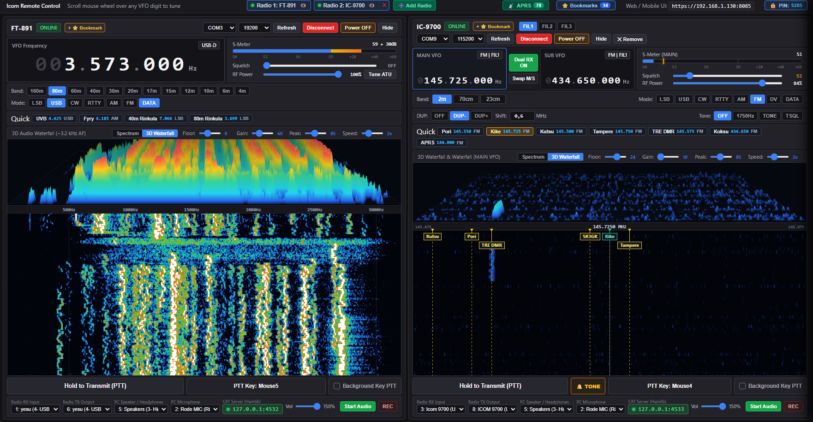

# Icom Remote - Dual Radio Web & Desktop Controller

A modern, high-performance remote control and spectrum monitoring application for **Icom transceivers** (specialized for **IC-7300** and **IC-9700**, compatible with other CI-V Icom radios).

Featuring real-time 2D/3D waterfall spectrum display, bidirectional low-latency audio streaming, built-in Hamlib `rigctld` server for WSJT-X / digital modes, frequency bookmarks, and a mobile-friendly HTTPS interface.



---

## ✨ Features

- **Dual Radio Management:**
  - Control two Icom radios simultaneously (e.g., **IC-7300** for HF/50 MHz and **IC-9700** for VHF/UHF/1.2 GHz).
  - Independent VFO A/B controls, Main and Sub VFO monitoring, split operation, and quick band switching.

- **High-Resolution 2D & 3D Waterfall & Spectrum Engine:**
  - Real-time CI-V spectrum scope capture directly over USB at up to 60 FPS.
  - **Perceptual Dynamic Range (`Gamma 0.55`):** Soft-knee transfer function illuminates faint signals and speech skirts (1.5–2.8 kHz) in vivid royal blue and cyan.
  - **Full 2.8 kHz SSB Audio Bandwidth:** Instantly recognize transmission width and sideband slope asymmetry (USB vs LSB) just like on the radio's physical LCD.
  - **Zero-Vertical-Streak Waterfall:** RF white-noise temporal decorrelation eliminates artificial column lines when idling.
  - **Dynamic Floor, Gain & Peak Controls:** Floor range `-30` to `+60` (default `0`), Gain `10` to `200`, and Peak ceiling controls with persistent memory.
  - **Interactive 3D Waterfall (3DSS):** High-density perspective surface ridges with synchronized dynamic range.
  - **Non-Intrusive CI-V Lifecycle:** Safely disconnects PTT without ever closing or hiding the spectrum scope on the radio's physical touchscreen.
  - **Click-to-Tune & Mouse Wheel Tuning:** Click anywhere on the spectrum or waterfall to tune; hover and scroll mouse wheel to step in 0.5 kHz grid-aligned increments.

- **Low-Latency Bidirectional Audio:**
  - Isolated audio paths: streaming audio to a mobile phone or remote browser does **not** trigger the local PC speakers in the shack.
  - Independent audio engines for each radio channel.
  - Remote PTT & high-quality microphone transmission with audio level monitoring.

- **Mobile Web Interface (HTTPS) & Configurable PIN Security:**
  - Fully responsive web UI accessible from any smartphone, tablet, or secondary laptop on your LAN/Wi-Fi or over VPN/Tailscale.
  - Secure HTTPS support for microphone input and Web Audio API permissions.
  - **Configurable PIN Protection:** Quick topbar button to change PIN code or disable PIN prompt completely for seamless local network access.
  - Dynamic server-side authentication and session management.

- **Built-in Hamlib `rigctld` Emulation:**
  - Integrated rigctld TCP servers (default ports `4532` and `4533`).
  - Connect **WSJT-X**, **JTDX**, **FLDigi**, **Log4OM**, or **N1MM** directly over TCP without needing physical CI-V splitters or virtual COM-port pairs.

- **Frequency Bookmarks & Interactive Reordering:**
  - Save current operating frequencies with one click directly from the radio header or bookmarks drawer (`+ ⭐ Bookmark`).
  - **Drag-and-Drop Reordering:** Freely rearrange saved station memories with drag handle (`⠿`) or quick `▲` / `▼` step buttons.
  - Auto-matching to active VFO and band (HF vs VHF/UHF) or manual target radio assignment.
  - Fully synced and persisted in `icom_config.json` and persistent webview storage.

- **Dual-Persistence Engine & Desktop App:**
  - Standalone desktop application window powered by PyWebView with dedicated persistent profile storage.
  - Waterfall controls (Noise Floor `-30..60`, Gain `10..200`, Peak Ceiling `30..160`, Speed `1x..5x`, and 2D/3D mode) and bookmarks automatically sync to `icom_config.json`.
  - System tray support with clean background operation.

---

## 🚀 Getting Started

### Prerequisites

- **Python 3.10+** (if running from source)
- Icom transceiver connected via standard USB cable (Silicon Labs CP210x USB to UART bridge driver installed).
- Windows, Linux, or macOS.

### Installation

1. **Clone the repository:**
   ```bash
   git clone https://github.com/jorks/icom-remote.git
   cd icom-remote
   ```

2. **Install dependencies:**
   ```bash
   pip install -r requirements.txt
   ```

3. **Configure your radios:**
   - Copy `icom_config.example.json` to `icom_config.json` (or let the app auto-generate it on first launch):
   ```bash
   cp icom_config.example.json icom_config.json
   ```
   - Set the appropriate COM ports (e.g. `COM8` for IC-7300 and `COM9` for IC-9700) and baud rate (`115200`).

4. **Run the application:**
   ```bash
   python server.py
   ```

---

## 📱 Mobile Remote Access

1. Ensure the host computer and your mobile device are connected to the same local network (Wi-Fi) or VPN.
2. In the desktop application, the local HTTPS URL is displayed (e.g. `https://192.168.1.xxx:8085`).
3. Open the URL in your mobile browser (Safari, Chrome, Firefox).
4. Because self-signed certificates are used for local LAN encryption, accept the browser certificate warning once to enable audio and microphone streaming.

---

## 🛠️ Configuration & WSJT-X Setup

### Connecting WSJT-X to Built-in rigctld
1. In WSJT-X, open **File -> Settings -> Radio**.
2. Set **Rig:** `Hamlib NET rigctl`.
3. Set **Network Server:** `127.0.0.1:4532` (for Radio 1 / IC-7300) or `127.0.0.1:4533` (for Radio 2 / IC-9700).
4. Set **PTT Method:** `CAT`.
5. Click **Test CAT** — it will immediately turn green!

---

## 📦 Building Standalone Executable (Windows)

To package the application into a single standalone `.exe` using PyInstaller:

```bash
pyinstaller server.spec
```

The resulting executable will be generated inside the `dist/` directory.

---

## 📄 License

This project is licensed under the MIT License - see the [LICENSE](LICENSE) file for details.
